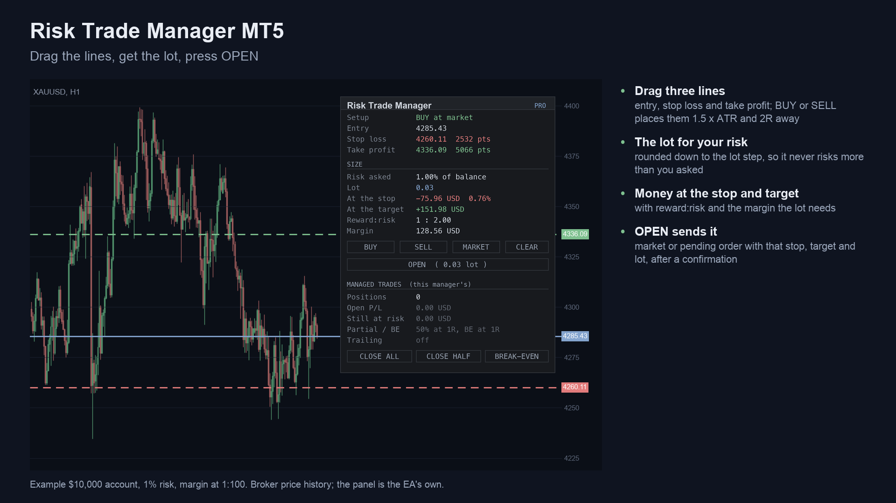
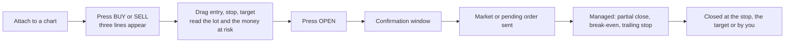
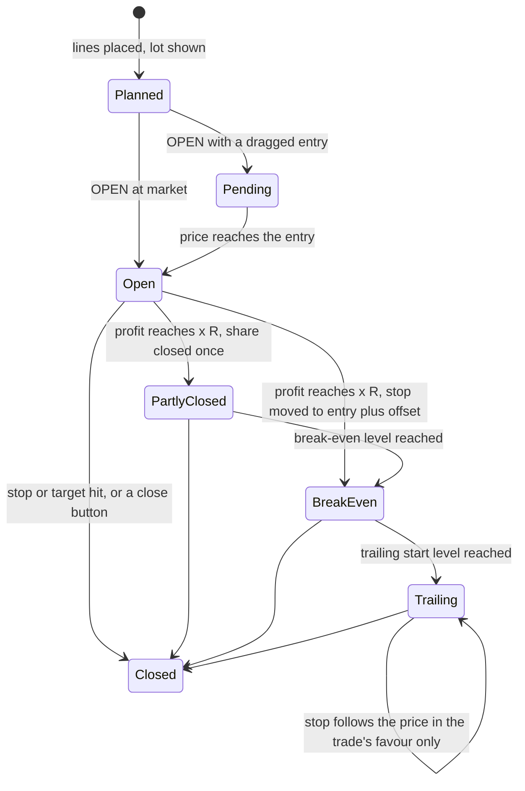
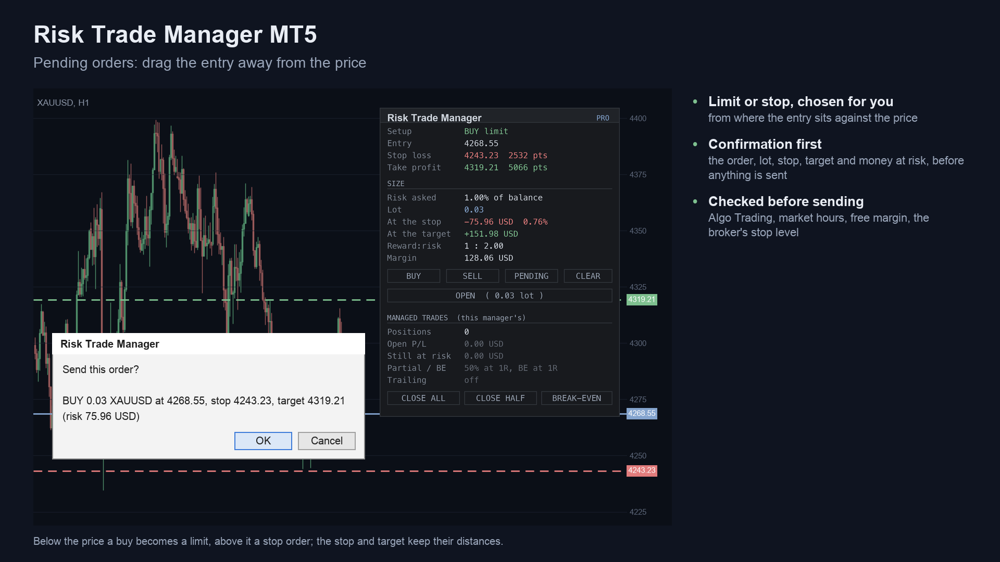
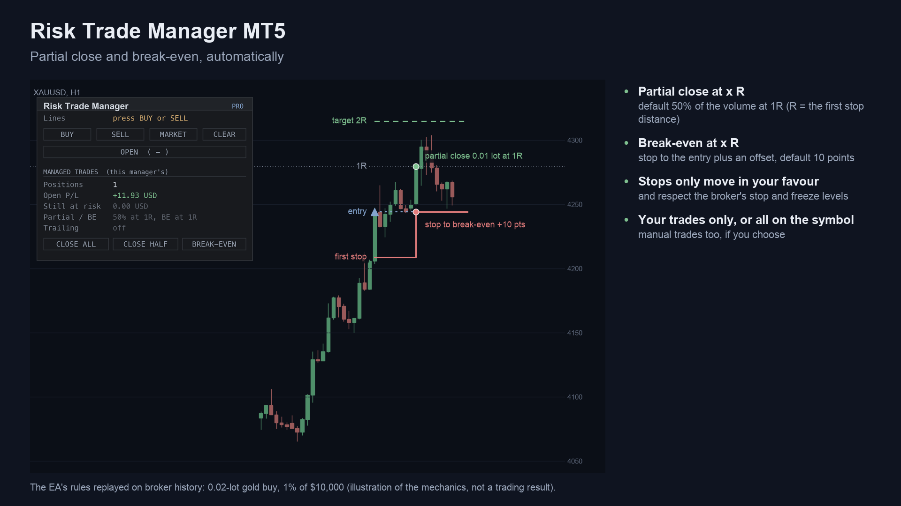
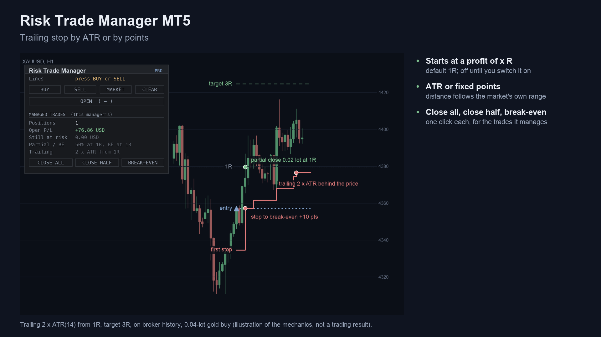
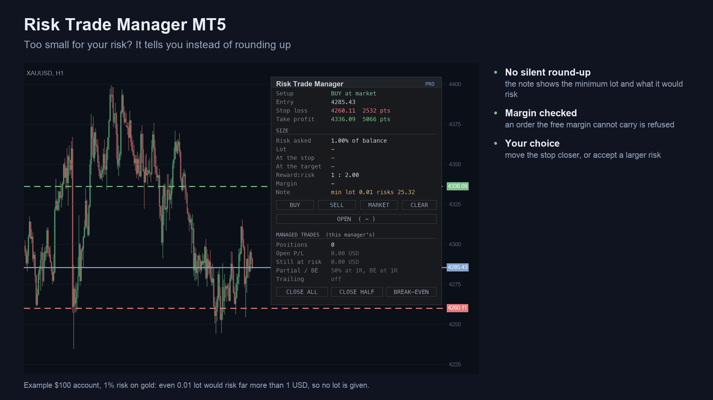
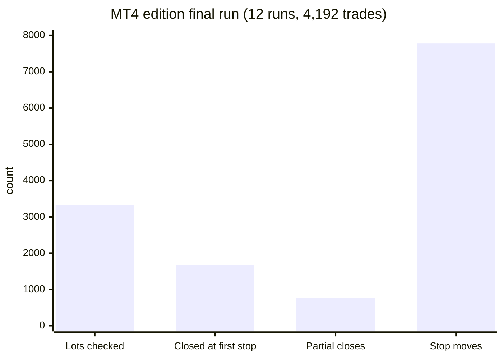
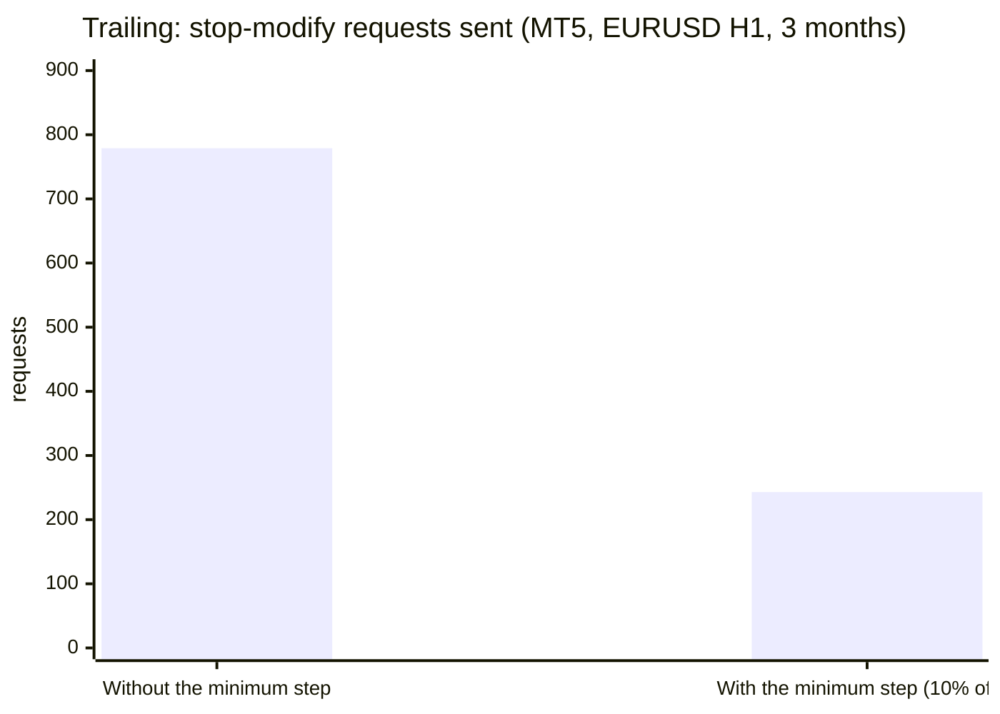

# Risk Trade Manager (MetaTrader 5 and MetaTrader 4)

A utility (Expert Advisor) that turns three chart lines into a correctly sized order, then manages the trade: partial
close, break-even and a trailing stop. It has no strategy and gives no signals; you decide the trade, it sizes and manages it.

> **This is a showcase repository: documentation and images only. There is no source code here.** The product is sold on
> the MQL5 Market. The free position-size calculator it builds on has public source:
> [allanninal/risk-position-tool](https://github.com/allanninal/risk-position-tool).

**Website:** [allanninal.dev/mql5 (utilities)](https://www.allanninal.dev/mql5/#utilities) · [MT4 editions](https://www.allanninal.dev/mql5/#mt4) · [allanninal.dev](https://www.allanninal.dev)
· **Contact:** message me on [LinkedIn](https://www.linkedin.com/in/allanninal/).

## Get it on the MQL5 Market

| Product | Platform | Price | Link |
|---|---|---|---|
| **Risk Trade Manager MT5** | MT5 | paid | <https://www.mql5.com/en/market/product/201867> |
| **Risk Trade Manager MT4** | MT4 | paid | MT4 edition: coming soon on the MQL5 Market |
| Risk Position Tool (calculates only, source on GitHub) | MT5 | free | <https://www.mql5.com/en/market/product/201865> |
| Risk Position Tool MT4 (calculates only, source on GitHub) | MT4 | free | MT4 edition: coming soon on the MQL5 Market |

The manager is standalone: you do not need to install the free tool to use it. Details, current price and the Strategy
Tester demo are on the Market pages.

## What it does

- **Three lines on the chart:** entry, stop loss and take profit. Drag them and read the lot for your risk, set as a % of
  the balance, a % of the equity or a fixed amount of money. The lot is rounded down to the broker's lot step, so the money
  at the stop is never above the risk you set. Below the minimum lot it says so instead of rounding up.
- **One-click order:** press OPEN to send a market order (while the entry line follows the price) or a limit or stop
  order (once you drag the line). A confirmation window shows the full order first; you can turn it off.
- **Checks before sending:** free margin, the broker's stop level, the spread, an open market and Algo Trading on. If
  something is wrong, the panel says what.
- **Management after entry:** partial close at x R (R = the stop distance at entry), break-even at x R plus a few points, a
  trailing stop by ATR or by points, and close all / close half / break-even buttons. Each can be left off (0).
- **Scope:** only the trades it opened, or every trade on the chart's symbol, manual ones included.
- **Prop Rules Guard lock:** it refuses new orders while Prop Rules Guard MT5 has the account locked (optional).
- **Opens a trade only when you press OPEN.** In the Strategy Tester only, it opens demo trades from its own lines so you
  can watch the behaviour; on a live or demo account it never opens a trade by itself.

### What a managed trade can go through

| | |
|---|---|
|  |  |
|  |  |

More screenshots: [sell setup](images/mt5/02-sell-setup.png), [Prop Rules Guard lock](images/mt5/06-prop-guard-lock.png),
[light theme](images/mt5/07-light-theme.png), [settings](images/mt5/09-settings.png),
[tool vs manager](images/mt5/10-tool-vs-manager.png). The MT4 edition's are in [`images/mt4/`](images/mt4).
Some screenshots are illustrations built from broker history, not terminal captures.

## Who it is for

Traders who decide their own entries and want the lot, the order and the follow-up handled consistently. If you only need
the lot size, the free [Risk Position Tool](https://www.mql5.com/en/market/product/201865) is enough.

## Why it was built

- Our October 2026 market research (MQL5 Market, Reddit, GitHub, freelance boards) found trade management, break-even,
  trailing and lot size is a recurring request: 205 matching posts in the Reddit archive sample (77 of them name MT4, MT5 or
  MQL). The research also calls MT5 demand on Reddit thin and low-volume.
- **The space is crowded.** The biggest MQL5 Market trade manager has hundreds of reviews and several free utilities rank
  beside paid ones. This product is not a claim of an unmet need; it adds a stricter sizing rule (the money at the stop is
  never above the risk set) and a minimum step for trailing so the broker is not sent a change on every tick.
- It pairs with the free calculator: the same lines and the same sizing rule, plus the order and the management.

## Main settings

From the Market listing. Defaults only; nothing is optimised and none of them is a recommendation.

| Setting | Default |
|---|---|
| Risk measured as | % of balance (or % of equity, or fixed money) |
| Risk per trade | 1.0 |
| Stop distance when the lines are placed | 1.5 x ATR(14); target 2 x the stop |
| Ask before sending an order | on |
| Manage | trades opened by this manager (or every trade on this symbol) |
| Partial close | 50% at 1 R (0 = off) |
| Break-even | at 1 R, plus 10 points (0 = off) |
| Trailing stop | off (or ATR(14) x 2, or 300 points); starts at 1 R |

## How it was checked (results)

Results of the MT4 edition's final run (MetaTrader 4 Strategy Tester, EURUSD, GBPJPY, XAUUSD, BTCUSD, H1, every tick,
January to October 2026, 12 runs):

| Check | Result |
|---|---|
| Overall | ALL PASS |
| Trades opened | 4,192 |
| Lots sized and checked against an independent lot calculation | 3,339, none above the risk asked |
| Trades closed at their first stop where the loss matched the panel (1%, 3% when the tick value moves) | 1,685 |
| Partial closes (one per trade, at or beyond the set R) | 770 |
| Stop moves, each in the trade's favour | 7,779 |
| Gap fills past the stop | 0 |
| Error lines | 0 |

MT5 edition (Strategy Tester, MQL5 validator-style set and EURUSD H1 January to March 2026):

| Check | Result |
|---|---|
| Release check | PASS: 0 error lines; EURUSD H1, XAUUSD D1, GBPUSD M30, EURUSD M1 at 10,000 and XAUUSD H1 at 100 all trade |
| Sizing checks | 1,713 checked lines: money at the stop never above the risk asked, always within one lot step of it |
| Trailing | every stop moved one way only, 0 errors; the minimum step of 10% of R cut modify requests from 779 to 243 |
| Partial close and break-even | fire on every forex run; gold at 0.01 lot cannot be split, so no partial there (by design) |

These are code and behaviour checks, not trading results. Version 1.01 of the MT5 edition sizes on the prices an order is
sent with (rounded to the symbol's tick); the MT4 test found that rounding issue first.

## Honest limits

- It sizes and manages trades you choose. It does not pick entries and no profit or accuracy claim is made.
- The risk is not exact: the lot is rounded down, so the risk is at or slightly below the amount you set. Slippage and gaps
  can make a stop fill further away.
- A trade without a stop loss has no R: it is not partially closed, moved to break-even or trailed.
- Management runs while the terminal runs. If the terminal is off, the stop and target sent with the order stay at the
  broker; partial closes and trailing wait until it is back.
- It works on one symbol per chart.
- The source is not published; this repository documents what the product does and the results of its checks.

## Free vs paid

| | Risk Position Tool (free) | Risk Trade Manager (paid) |
|---|---|---|
| Lines, lot for your risk, money at stop and target, reward:risk, margin | yes | yes |
| Sends the order (market or pending) | no, calculates only | yes, with a confirmation |
| Partial close, break-even, trailing stop, close buttons | no | yes |
| Program type | indicator | Expert Advisor |
| MT5 | [201865](https://www.mql5.com/en/market/product/201865) | [201867](https://www.mql5.com/en/market/product/201867) |
| MT4 | coming soon | coming soon |
| Source | [public on GitHub](https://github.com/allanninal/risk-position-tool) | not published |

---

**Website:** [allanninal.dev/mql5](https://www.allanninal.dev/mql5/#utilities) · [MT4](https://www.allanninal.dev/mql5/#mt4) · [allanninal.dev](https://www.allanninal.dev)
· Questions: message me on [LinkedIn](https://www.linkedin.com/in/allanninal/). All rights reserved, see [LICENSE](LICENSE).
